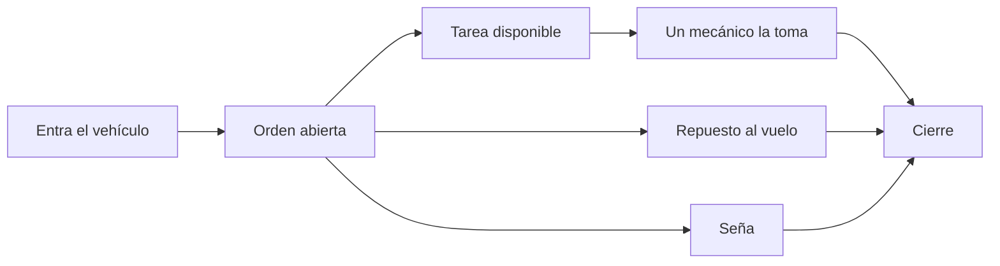
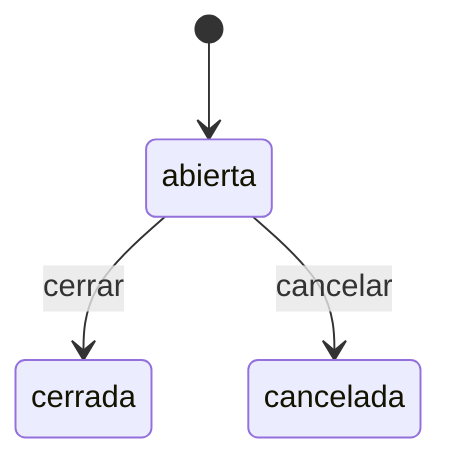
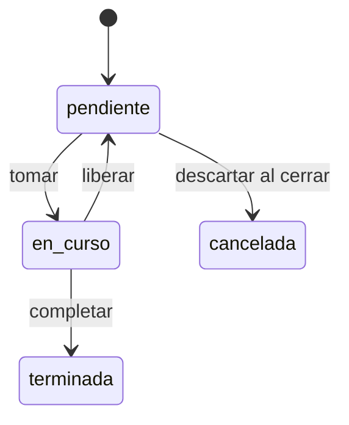

# Gestión de Taller

[](https://github.com/MartinSimon08/MetodologiasAgiles/actions/workflows/ci.yml)
[](LICENSE)
[](https://github.com/MartinSimon08/MetodologiasAgiles/stargazers)
[](https://github.com/MartinSimon08/MetodologiasAgiles/actions/workflows/coverage.yml)

Software de gestión para un taller mecánico único, pensado para el dinamismo real de un taller: los mecánicos atienden vehículos según disponibilidad (no hay asignación fija), y los repuestos se compran al vuelo sin stock permanente, cargándose a la orden con su costo real.

El backend es una API Ruby on Rails (modo `--api`). El frontend React vive en `frontend/` y es la pantalla de recepción y la vista móvil de los mecánicos. En local, `docker compose up` levanta la base, la API y el frontend. La guía del frontend está en [`frontend/README.md`](frontend/README.md).

## Qué hace

- Registrar clientes y vehículos, y abrir una orden cuando entra un auto.
- Crear tareas en la orden. Cualquier mecánico libre las toma, las termina o las libera.
- Anotar en la tarea lo que se encontró. El mecánico recibe un aviso en vivo cuando aparece una tarea nueva.
- Avisar un repuesto comprado en el momento, sin stock. El administrador carga costo, margen y proveedor, o lo toma del catálogo.
- Registrar señas mientras la orden sigue abierta.
- Ver el total parcial y cerrar la orden. El cierre congela el total a cobrar. Cancelar libera las tareas en curso y conserva el historial.
- Dar de alta usuarios, desactivarlos y resetear la contraseña. El margen por defecto del taller se configura aparte.

No es un ERP ni un sistema de stock. Hay un solo taller, sin sucursales ni inventario permanente. La mano de obra y los repuestos viven en la orden.

## Un día en el taller

1. Entrá en <http://localhost:5173/login> con el administrador que creó el seed.
2. Si falta el cliente o el vehículo, dalo de alta en Clientes y Vehículos.
3. Abrí una orden desde Órdenes, con el motivo de ingreso.
4. Cargá las tareas. Creá un usuario mecánico en Usuarios, entrá con ese usuario y tomá una tarea en Mis tareas.
5. Cargá un repuesto desde la orden, o avisalo como mecánico y valorizalo como administrador. Si el cliente deja una seña, registrala en la misma orden.
6. Cerrá la orden cuando no hay tareas en curso ni repuestos sin valorizar. Las tareas que nadie tomó se pueden descartar: quedan canceladas y no se cobran.

El repuesto y la seña se cargan con la orden abierta. El dibujo muestra el recorrido, no un orden obligatorio entre esas dos cosas.



El precio al cliente de un repuesto valorizado es `costo unitario × cantidad × (1 + margen / 100)`. El saldo de la orden es el total menos las señas.

## Estados

Una orden abierta se cierra o se cancela. No vuelve atrás.



Para cerrar no puede haber tareas en curso ni repuestos sin valorizar. Las tareas pendientes se descartan o frenan el cierre. Cancelar libera las que estaban en curso.

Una tarea la toma cualquier mecánico libre. Si la libera, vuelve a estar disponible.



## Quién puede hacer qué

| Acción | Administrador | Mecánico |
| --- | --- | --- |
| Abrir, cerrar o cancelar una orden | sí | no |
| Ver órdenes | sí | sí |
| Crear tareas y ponerles precio | sí | no |
| Tomar, completar o liberar una tarea | no | sí |
| Dejar una nota en la tarea | no | sí |
| Ver costos, margen y precio al cliente | sí | no |
| Cargar un repuesto con costo | sí | no |
| Avisar un repuesto para valorizar después | no | sí |
| Valorizar, señas, usuarios y catálogos | sí | no |

| Ruta | Quién | Para qué |
| --- | --- | --- |
| `/login` | ambos | Entrar |
| `/ordenes` y `/ordenes/:id` | ambos | Listado y detalle de la orden |
| `/mis-tareas` | mecánico | Tomar el trabajo disponible |
| `/clientes` y `/vehiculos` | administrador | Padrones |
| `/repuestos` | administrador | Catálogo de repuestos |
| `/tareas-frecuentes` | administrador | Catálogo de tareas |
| `/usuarios` | administrador | Altas, bajas y contraseñas |
| `/configuracion` | administrador | Margen por defecto |

`/` redirige a `/ordenes` o a `/mis-tareas` según el rol.

## Stack

- Ruby 4.0.7 (`.ruby-version`, pensado para rbenv)
- Rails 8.1 (modo API)
- PostgreSQL 16, la API y el frontend, vía Docker Compose
- Frontend: Vite, React y TypeScript en `frontend/` (pnpm)
- RSpec + FactoryBot
- Autenticación por JWT (roles: mecánico / administrador)

## Requisitos previos

- Ruby 4.0.7. Dentro del repo, `rbenv install` lee `.ruby-version`.
- Bundler 4.0.21, la versión con la que se generó `Gemfile.lock`:
  ```
  gem install bundler -v 4.0.21
  ```
- Docker y Docker Compose. Con eso alcanza para levantar la app y correr los tests.
- Para correr RuboCop o el lint del frontend en el host: las librerías nativas y Node.js con pnpm. Node tiene que ser `^20.19.0` o `>=22.12.0`, que es lo que exige Vite 8. En Debian/Ubuntu:
  ```
  sudo apt-get install -y build-essential git libpq-dev libyaml-dev libvips pkg-config
  ```

Compose publica la base en el puerto 5432, la API en el 3000 y el frontend en el 5173. Esos tres puertos tienen que estar libres.

## Variables de entorno

Copiá `.env.example` a `.env` en la raíz. Docker Compose lee ese archivo al crear el contenedor. Rails lo carga en development y test con `dotenv-rails`.

Completá `DB_USER`, `DB_PASSWORD` y `DB_NAME`. Con alguna vacía, el contenedor de Postgres no arranca.

- `DB_USER` y `DB_PASSWORD`: usuario con el que Rails se conecta.
- `DB_NAME`: base inicial que crea la imagen de Postgres la primera vez.
- La app usa otras dos bases, fijas en `config/database.yml`: `metodologias_agiles_development` y `metodologias_agiles_test`. El usuario de `DB_USER` tiene que poder crearlas. En la imagen oficial, ese usuario es superusuario.
- `ADMIN_EMAIL` y `ADMIN_PASSWORD`: identifican al administrador que crea el seed. Sin las dos, el seed no crea ningún usuario.
- `ADMIN_NOMBRE`: nombre de ese administrador. Si falta, el seed usa `Administrador`.

## Setup local

1. Cloná el repo y parate en la raíz.
2. Copiá y completá `.env`, como está arriba.
3. Levantá todo:
   ```
   docker compose up --build
   ```

Un solo comando levanta la base, la API y el frontend, en ese orden: la API espera a que Postgres esté listo y el frontend espera a la API. La primera vez construye las imágenes, instala gemas y dependencias del frontend, migra la base y corre el seed. Después alcanza con `docker compose up`. Para dejarlo en segundo plano: `docker compose up -d --wait`, que vuelve cuando los tres servicios responden.

Para bajar todo:

```
docker compose down
```

Baja y elimina los tres contenedores juntos. Los datos de la base quedan en el volumen `pgdata`.

> [!WARNING]
> `docker compose down -v` borra el volumen `pgdata`. La base queda vacía.

El stack se llama siempre `metodologiasagiles`, sin importar el nombre de la carpeta. Un `docker compose down` desde cualquier worktree baja el mismo stack.

El contenedor de la API corre como el usuario `1000`. Si el tuyo es otro (`id -u`), agregá `HOST_UID` y `HOST_GID` en `.env`.

> [!TIP]
> Hacen falta `ADMIN_EMAIL` y `ADMIN_PASSWORD` en `.env` para que el seed cree el administrador. Sin las dos, no hay usuario para entrar.

Otros usuarios, incluido un mecánico, se dan de alta después desde la pantalla Usuarios.

## Cómo acceder

- Interfaz: <http://localhost:5173/login>
- API: <http://localhost:3000>
- Chequeo de que la API responde: `GET http://localhost:3000/up`

Entrá con el email y la contraseña de `ADMIN_EMAIL` y `ADMIN_PASSWORD`.

> [!IMPORTANT]
> Abrí el frontend en `http://localhost:5173`. CORS solo permite ese origen. `http://127.0.0.1:5173` no pasa.

Vite usa el puerto 5173 y no lo cambia: si está ocupado, el frontend no arranca.

## Tests

Con el stack levantado, prepará la base de test y corré la suite dentro del contenedor de la API:

```
docker compose exec -e RAILS_ENV=test api sh -c "bin/rails db:test:prepare && bundle exec rspec"
```

Un solo archivo:

```
docker compose exec -e RAILS_ENV=test api bundle exec rspec spec/services/tarea_tomar_spec.rb
```

La suite del proyecto es RSpec. El job `test` del CI corre `bin/rails test` y no ejecuta esos specs.

## Desarrollo

Con el stack levantado:

```
docker compose exec api bin/rails console
docker compose exec api bin/rubocop
docker compose exec frontend pnpm lint
docker compose exec frontend pnpm exec tsc -b --pretty false
```

## Mapa del repositorio

- `app/`: API Rails. Los controllers reciben el request y delegan.
- `app/services/`: el flujo de la orden (`OrdenAbrir`, `TareaTomar`, `RepuestoAgregar`, `OrdenCerrar`).
- `frontend/src/features/`: pantallas por dominio. La guía está en [`frontend/README.md`](frontend/README.md).
- `spec/`: RSpec y FactoryBot.
- [`docs/repuestos.md`](docs/repuestos.md): catálogo y repuestos cargados en la orden.
- [`docs/deploy.md`](docs/deploy.md): deploy a producción con Kamal.
- [`docs/trello-github.md`](docs/trello-github.md): tickets de Trello e issues de GitHub.

## Deploy

Cada merge a `main` que pasa el CI se despliega solo con Kamal a una VM gratuita de Oracle Cloud. La app queda en `https://204-216-155-6.sslip.io`. Detalles, secrets y comandos: [Deploy a producción](docs/deploy.md).

## Convenciones del proyecto

- **Arquitectura**: MVC estándar de Rails + objetos de servicio para la lógica de negocio (`app/services/`). Los controllers reciben el request y delegan. Los modelos ActiveRecord manejan persistencia, relaciones y validaciones de datos.
  - Ejemplos de servicios: `TareaTomar`, `TareaLiberar`, `OrdenAbrir`, `RepuestoAgregar`.
- **Concurrencia de tareas**: tomar una tarea usa lock optimista (`lock_version`) o `with_lock` explícito, para evitar que dos mecánicos tomen la misma tarea al mismo tiempo.
- **Tiempo real**: al crear una tarea, la API avisa por Action Cable (Solid Cable). En development el adapter es `async`. El cliente del mecánico está en `frontend/src/lib/cable.ts`.
- **Commits y pull requests**: el título y cada commit siguen [Conventional Commits](https://www.conventionalcommits.org/) en la forma `tipo(scope): descripción`, en español, imperativo y sin punto final. El CI lo valida con `script/check-conventional-commits`. La descripción del PR usa [`.github/PULL_REQUEST_TEMPLATE.md`](.github/PULL_REQUEST_TEMPLATE.md).

## Contribuir

Para proponer un cambio, leé [CONTRIBUTING.md](CONTRIBUTING.md). Una vulnerabilidad se reporta en privado, como dice [SECURITY.md](SECURITY.md). Los revisores del grupo están en [`.github/CODEOWNERS`](.github/CODEOWNERS).

## Licencia

Código bajo la licencia [MIT](LICENSE).
